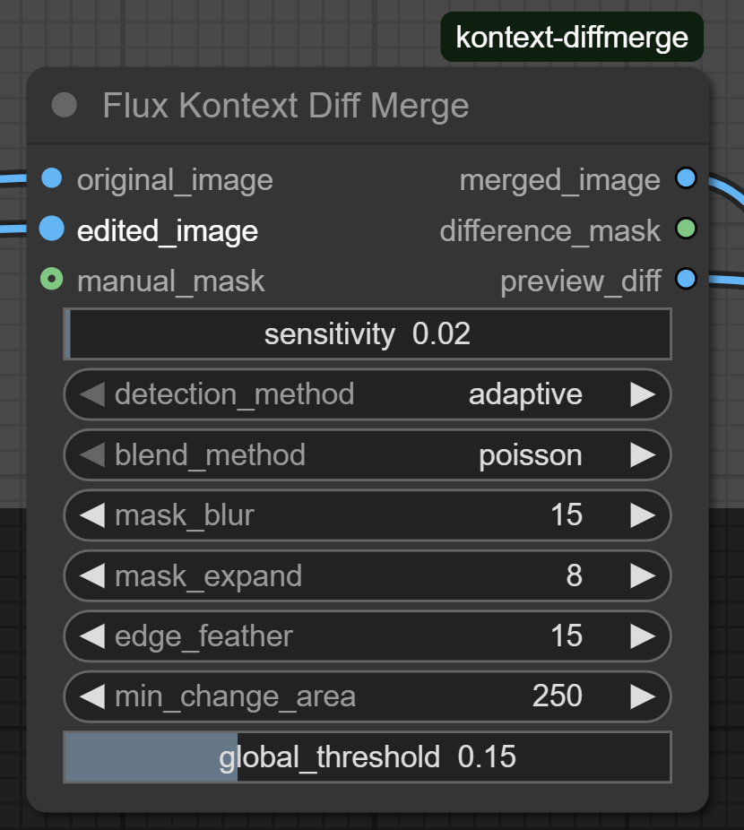

# Flux Kontext Diff Merge

A ComfyUI custom node that preserves image quality by selectively merging only the changed regions from AI-generated edits back into the original image. Perfect for use with Flux Kontext Dev to prevent quality degradation in unchanged areas.

## Features

- **Adaptive Detection**: Robust to global AI processing changes using LAB color space
- **Optional Translation Alignment**: Compensates for small global position shifts when unchanged regions agree
- **Area Filtering**: Removes small noise areas that aren't real changes
- **Multiple Detection Methods**: Adaptive, color difference, SSIM, and combined approaches
- **Multiple Blending Methods**: Poisson, alpha, multi-band, and Gaussian blending
- **Intelligent Masking**: Automatic mask refinement with morphological operations
- **Preview Capability**: Shows detected changes with visual overlay
- **Batch Processing**: Processes full batches; broadcasts a single original over a multi-image edited batch
- **Robust Poisson**: Stable center selection and safe padding when masks touch image edges

## Installation

### Method 1: Git Clone (Recommended)
1. `cd ComfyUI/custom_nodes/`
2. `git clone https://github.com/safzanpirani/flux-kontext-diff-merge.git`
3. Launch ComfyUI.


### Method 2: Manual Installation
1. Create folder: `ComfyUI/custom_nodes/flux-kontext-diff-merge`
2. Copy all files into this folder
3. Restart ComfyUI

## Usage

### Basic Workflow
1. **Load your original image** (before AI editing)
2. **Process with Flux Kontext Dev** to get your edited image
3. **Add the Flux Kontext Diff Merge node**
4. **Connect inputs**:
   - `original_image`: Your original unedited image
   - `edited_image`: The AI-edited output from Flux Kontext Dev
5. **Use recommended settings** (see below)

### Node Inputs



#### Required Inputs
- **`original_image`** (IMAGE): Connect from your FluxKontextImageScale node
- **`edited_image`** (IMAGE): Connect from your VAEDecode node

#### Parameters
- **`threshold`** (0.01-1.0, default: 0.02): Controls change detection threshold (increasing this reduces the size of the detected mask)
- **`detection_method`**: Choose detection approach
  - **`adaptive`**: Best for AI-processed images (recommended)
  - `color_diff`: Simple color differences
  - `ssim`: Structural similarity
  - `combined`: Multiple detection methods
- **`global_threshold`** (0.01-0.5, default: 0.15): Accounts for overall colour/lighting changes, not geometric shifts
- **`min_change_area`** (0-5000, default: 250): Minimum area size for valid changes
- **`blend_method`**: Choose blending technique
  - **`poisson`**: Best for seamless integration (recommended)
  - `alpha`: Simple linear blending
  - `multiband`: Multi-scale blending for complex changes
  - `gaussian`: Smooth falloff blending
- **`mask_blur`** (1-100, default: 15): Blur amount for mask edges
- **`mask_expand`** (0-50, default: 8): Pixels to expand the change mask
- **`edge_feather`** (0-50, default: 15): Additional edge softening

#### Optional
- **`manual_mask`**: Override automatic detection with your own mask, in original-image coordinates
- **`alignment`** (`none` / `translation`, default: `none`): Opt into conservative translation registration before detection and blending
- **`max_alignment_shift`** (1-64, default: 16): Largest accepted translation in pixels along either axis

### Node Outputs
- **`merged_image`**: The final quality-preserved image
- **`difference_mask`**: The detected change mask
- **`preview_diff`**: Preview showing detected changes highlighted in red

### Batch Support

This node fully supports batch workflows:

- If `original_image` and `edited_image` have the same batch size, items are processed pairwise
- If `original_image` has batch size 1 and `edited_image` > 1, the original is automatically broadcast to match the edited batch
- `manual_mask` may be a single mask (broadcast) or a batch of masks; masks are resized per item to match image dimensions
- All outputs (`merged_image`, `difference_mask`, `preview_diff`) are returned as batches

### Global position shifts (including Nano Banana edits)

By default, the node compares the images at the same pixel coordinates. Adaptive
LAB detection compensates for colour changes; it does **not** align geometry.
For edits shifted a few pixels, choose `alignment: "translation"`. Each batch
item is registered separately, after any existing resize to the original size.
The output remains in the original image's coordinate system.

Alignment uses phase correlation on a 3×3 grid of grayscale tiles. A translation
is accepted only when at least four textured tiles (grayscale standard deviation
≥2, correlation response ≥0.3) agree within one pixel per axis, span at least two
rows and two columns, and stay within `max_alignment_shift`. The median of the
largest agreeing group is validated: at least four supporting tiles spanning two
rows and columns must each reduce mean absolute grayscale error by at least 20%
on their covered pixels. This distributed agreement avoids aligning to a single
repainted or moved object. It assumes substantial unchanged, textured background.

Only translation is supported, not rotation, zoom, perspective, or nonrigid
deformation. Images smaller than 96 pixels on either axis, low-texture images,
large edits, repetitive patterns, or weak/ambiguous matches may remain unaligned.
When the criteria fail, the node uses the edited image as supplied; inspect the
preview rather than assuming registration succeeded. Leave alignment disabled
when the intended edit is itself a global translation.

Near-integer estimates (within 0.15 pixels) are snapped to avoid unnecessary
resampling; other translations use bilinear interpolation. Missing border pixels
are retained from the original and excluded from the output mask, including
manual masks and feathering. A manual mask must describe the desired edit in
**original-image coordinates**, not the shifted edited-image coordinates.

## Optimal Settings

### Object Replacement
```
threshold: 0.02
detection_method: "adaptive"
global_threshold: 0.15
min_change_area: 250
blend_method: "poisson"
mask_blur: 15
mask_expand: 8
edge_feather: 15
```

### Poisson Blending Notes

- Poisson now selects the blend center using a distance transform (most interior point) for stability across thresholds
- If the mask touches the image border, the node performs reflect-padding under the hood and crops back, avoiding ROI errors and position jumps
- Poisson internally treats masks as binary; for very soft edges, consider `multiband` or `gaussian`

## Results

### Example 1: Object Replacement


### Example 2: Dog to Cat Replacement


## Why Use This Node?

When Flux Kontext Dev processes an image, it introduces subtle changes throughout the entire image. This node:

- ✅ Preserves original image quality in unchanged areas
- ✅ Only applies AI changes where they're actually needed
- ✅ Handles global colour artifacts adaptively; small position shifts require optional translation alignment
- ✅ Provides seamless blending between original and edited regions

## Requirements

- ComfyUI
- Python 3.8+
- OpenCV (opencv-python)
- scikit-image
- NumPy
- SciPy
- Pillow

## License

MIT License - feel free to use and modify for your projects.

## Troubleshooting

### Entire image shows red overlay
If the edited image is globally displaced, enable `alignment: "translation"`
first; threshold changes cannot register image positions. See the alignment
criteria and limitations above.

1. **Increase** `global_threshold` to 0.20+
2. **Increase** `threshold` to 0.03
3. **Use** `detection_method: "adaptive"`
4. **Increase** `min_change_area` to 500+

### No changes detected
1. **Decrease** `global_threshold` to 0.08
2. **Decrease** `threshold` to 0.01
3. **Decrease** `min_change_area` to 100
4. **Check** the `preview_diff` output for debugging 

### Batch shape mismatches
1. If you pass a single original and a batched edited input, the node will broadcast the original automatically
2. If you pass mismatched batch sizes otherwise, you will get an error; align batch sizes or use broadcasting as above

## What's New

- Optional conservative translation alignment with distributed tile agreement, error validation, and original-preserving borders
- Batch processing with original-image broadcasting when edited batch > 1
- Poisson blending is robust to edge-touching masks (reflect padding) and uses distance-transform center selection
- Per-parameter tooltips and improved in-node documentation for easier tuning
